<picture>
  <source media="(prefers-color-scheme: dark)" srcset="assets/header-dark.svg" />
  
</picture>
 

**Axel Hamilcaro, fullstack developer and builder.** I build the APIs and foundation tools other people build their products on, rather than SaaS that consume those APIs. My bet for 2026 and 2027: ship the tool and the data, not the final application. Based in Tours, France, working remote.

By day I'm a fullstack developer at [Eskimoz](https://www.eskimoz.fr). The rest of the time I build the tools listed below, open source first. I still take a few freelance projects. More on [axelhamilcaro.com](https://axelhamilcaro.com).

 

<picture>
  <source media="(prefers-color-scheme: dark)" srcset="assets/titles/quests-dark.svg" />
  
</picture>

- **[Eskimoz](https://www.eskimoz.fr)** 2026, now Eskimoz is a digital acquisition agency, best known for SEO. I'm a fullstack developer there, across the whole chain: interface, API, jobs and the infra that runs them. What I build there belongs to the team, so I say no more here.
- **[OpenUp](https://openup.to)** 2026, now A founder's SaaS stuck for months, aiming to replace Bitly, Linktree and Beacons in one product. I restarted it from scratch with him and I'm now its technical founder: short links with native deep links, dynamic QR codes for Apple and Google Wallet, WYSIWYG link-in-bio, analytics, custom domains, 4 Stripe plans. Clean Architecture with 9 domain modules, Cloudflare edge under 50ms, iOS, Android and PWA from one codebase.
- **[Odyssée](https://odyssee-nautique.com)** 2026, freelance Kayak and paddle stations with nobody on site: the whole rental has to work alone, from the booking to the padlock on the dock. You book, you pay, an SMS sends your code, a connected padlock opens. As technical consultant I set the architecture and infra, designed the IoT flow from booking to padlock, hired and onboarded the developer, and planned the migration of live customers from the previous provider. Multi-tenant on Next.js and Payload: each operator gets their own domain, brand, Stripe account and walled-off data.
- **[HomeCafé](https://homecafe.app)** 2026, freelance, in progress A founder with an idea for mental health professionals and no product yet. The goal: an MVP real enough to convince investors. I coded it from scratch, web and mobile, it helped raise funds, and the build goes on: 70+ business flows so far. Next.js, Expo, Fastify, PostgreSQL.
- **[L'Instant Tranquille](https://www.instant-tranquille.com)** 2026, freelance A holiday home in Sologne, up against every listing on Airbnb and Booking. The goal: become the place a tourist lands on when they search, or ask an AI, where to stay in Sologne, then send them on to book. SEO and GEO pushed to the max with structured data, hreflang, llms.txt, AI crawlers welcomed, IndexNow on every deploy and local search. The CMS installs as a full PWA: the owner runs the site, emails included, from an icon on her phone, and everything else is automated. Generated animated landscapes so the place feels like itself. Next.js and Payload CMS.
- **[Douche Senior France](https://www.douche-senior-france.com)** 2026, freelance A local craftsman fitting safe walk-in showers for seniors in Centre-Val de Loire. The problem: the customers are elderly people and their families, who search on Google or ask an AI and give up on a site they can't read. The goal: be the answer they get, then turn it into a call or a quote request. Built for senior readers first (large type, plain words, short paths), with SEO and GEO pushed to the max: structured data, llms.txt, AI crawlers welcomed. The CMS installs as a full PWA: the craftsman runs the site, emails included, from an icon on their phone, and everything else is automated. Next.js and Payload CMS.
- **[ScormPilot](https://www.scormpilot.com)** 2025, now, freelance Once a SCORM module is sent to a client's LMS, training organizations lose control of it: no updates, no tracking, no way to pull it back. ScormPilot gives that control back: upload, versioning and remote control, with the source swapped without reloading on the learner's side. 5 apps shipped solo (Fastify API, Next.js dashboard, React player, SCORM runtime, Teams app), multi-tenant with schema per tenant, hosted in Europe, used by around ten organizations and thousands of learners, 99.9% uptime.
- **[MentorTroc](https://www.mentortroc.com)** 2025, freelance An early-stage skill-sharing platform that needed its community features and a codebase able to grow. I built the community module and real-time messaging, audited performance and architecture, and structured the product to scale. React, GraphQL, Node, PostgreSQL.
- **[Billetterie](https://axelhamilcaro.com/portfolio/billetterie)** 2024 to 2025, freelance A full ticketing system needed for one event with a hard deadline, while several box office agents sell the same seats at once. Shipped solo in a month: 2D/3D seating chart synced over WebSocket under 200ms so no seat sells twice, live KPIs, multi-VAT pricing, Stripe payments, PDF tickets, NestJS APIs. Adopted by the operations team on day one.
- **[Superprof](https://www.superprof.fr)** 2024 to 2025 Junior developers who can code but get stuck on exams, real projects and interviews. Started when I became a lead at Civitime: around ten developers coached to pass their exams, ship their projects and get hired, with clean code and SOLID for everyone and Clean Architecture for the most advanced. 4 of them now hired or in advanced training.
- **[Civitime](https://www.civitime.com)** 2021 to 2024 B Corp platform that trains 250,000+ employees on CSR through serious games, held back by a legacy core where business and tech were tangled and by content made with a chain of manual tools. Over 4 years, from developer to tech lead: built the games (city builder, quizzes, escape games), rebuilt the core on Clean Architecture, DDD and event sourcing so CSR history became auditable, built a scenario editor with a RAG assistant that halved the content team's iteration time, then led the new SCORM product from scoping to production.
- **[Wild Code School](https://www.wildcodeschool.com)** 2020 to 2021 Web and mobile application developer degree.
- **[DUT Mesures Physiques, IUT de Blois](https://iut-blois.univ-tours.fr)** 2017 to 2019 Physics measurement degree: electronics, sensors and my first serious Python. Explains why IoT projects make me smile.

 

<picture>
  <source media="(prefers-color-scheme: dark)" srcset="assets/titles/forge-dark.svg" />
  
</picture>

- **Weathertop**: a data API. You send it prompts in volume and it returns what AI assistants really answer, in a form code can use. A personal project, in the works for 6 months, not released yet.
- **Afterlive**: turns the recording of a live stream, or any long video, into short clips, edited and ready to post. 2 hours of video processed in about 5 minutes, around fifteen clips and more if needed. In production soon.
- **Brumeval**: an experiment in fully automated asset creation for a 3D world, from a one-line description to an animated, game-ready character. It feeds a tactical game seen from above, with an open world and turn-based combat. In progress.
- **Tirith**: an editorial engine that never invents a topic. It starts from what really happened, drafts a post, waits for my call, then traces each opportunity back to the post that brought it. In progress.
- **Deisis**: a NixOS appliance for self-hosted AI agents, where an update can never break the box: system and data roll back together on failure. In progress.
- **optimize-site-geo**: a Claude Code skill that maintains a site's SEO and GEO on its own, every week: it measures, sorts regressions from opportunities, fixes them in the site's own tone and reports. Private.

 

<picture>
  <source media="(prefers-color-scheme: dark)" srcset="assets/titles/artifacts-dark.svg" />
  
</picture>

- [clean-stack](https://github.com/axelhamil/clean-stack): clone it and write only business logic. Passkeys, TOTP, magic links, GDPR erasure and export, multi-tenancy enforced on every table from the first migration, and one authorization rule enforced in server, router and UI.
- [inwire](https://github.com/axelhamil/inwire): dependency injection with no decorators and no tokens. A proxy records the real dependency graph and hands it to you as JSON, cycles come with the full chain and a fix hint. About 5 KB, zero dependencies, runs on Node, Bun, Deno, Workers and browsers.
- [galvorn](https://github.com/axelhamil/galvorn): Rust's `Option`, `Result` and exhaustive `match()` for TypeScript. Zero dependencies, 100% coverage.
- [aggregate-kit](https://github.com/axelhamil/aggregate-kit): the DDD building blocks extracted from clean-stack, published on npm with provenance. A repository scoped to its owner reads a stranger's data as absent, never forbidden, so nothing leaks.
- [ts-lib-template](https://github.com/axelhamil/ts-lib-template): a library ready to publish on day one, with release PRs, npm trusted publishing and the package shape checked on every build.
- [lambe](https://github.com/axelhamil/lambe): a Chrome extension that translates web pages and YouTube captions in place, with a local model through Ollama or any OpenAI-compatible server.

 

<picture>
  <source media="(prefers-color-scheme: dark)" srcset="assets/titles/palantiri-dark.svg" />
  
</picture>

- [burnrate](https://github.com/axelhamil/burnrate): tells you whether to push or hold back. It projects where your 5-hour and 7-day quotas will land at reset, gives a daily budget, and says it plainly: ease off, room to spare, or limit hit around 4 pm.
- [ccwatermelon](https://github.com/axelhamil/ccwatermelon): a 3-line statusline drawn in about 40 ms, that warns you before the quota runs out and counts the tokens left before auto-compaction. Green rind while there's room, red flesh when there isn't.
- [claude-window](https://github.com/axelhamil/claude-window): pins your 5-hour window to a fixed hour by reading the real reset time from the API, then chains windows all day with 3 or 4 wake-ups and no polling.
- [cockpit](https://github.com/axelhamil/cockpit): lets a non-developer run a SaaS on Railway by talking to Claude. It installs Metabase, n8n and Uptime Kuma fitted to the app, watches health, errors, costs and backups, logs every change with its undo, and "cancel that" works.
- [opencode-steps](https://github.com/axelhamil/opencode-steps): deterministic agent workflows for OpenCode. You write the steps as a tree read top to bottom, code decides what runs next, and no model picks the order, so no step gets skipped. Work in progress.
- [cursor-statusline](https://github.com/axelhamil/cursor-statusline): the same idea for the Cursor Agent CLI, with model, git, context and quota pools.

 

<picture>
  <source media="(prefers-color-scheme: dark)" srcset="assets/titles/shire-dark.svg" />
  
</picture>

[nixos-forge](https://github.com/axelhamil/nixos-forge): not a distro, the forge where you build your own NixOS distro. Fork it, customize everything, and CI tests every machine before it reaches you: build, VM boot, install on a blank disk. Encrypted disk, a root wiped at every boot, hourly snapshots, and a PR with fresh inputs every Monday. Work in progress. My [dotfiles](https://github.com/axelhamil/dotfiles) run Arch and Hyprland, with Claude agents tracked right in the terminal tabs and tmux panes.

Older experiments, archived quests and honest mistakes

 

- **Dofus, as a teenager**: my first quest. Bots and patched game clients in Java. That's where reading other people's code started.
- [PlagueOff](https://github.com/axelhamil/PlagueOff): my first PHP project, from my first hackathon. A stop-covid app set during the Black Death. Hand-rolled MVC.
- [L-Annuaire-du-DEV](https://github.com/axelhamil/L-Annuaire-du-DEV): a directory of front and back end resources, from when I was collecting everything.
- [nextjs-most-important-features](https://github.com/axelhamil/nextjs-most-important-features): Server Actions and Server Components, learned out loud.
- [clean-archi-todolist-nextjs](https://github.com/axelhamil/clean-archi-todolist-nextjs): DDD and Clean Architecture on a todo list. Yes, a todo list. Everyone has one.
- [nextjs-auth-solid](https://github.com/axelhamil/nextjs-auth-solid): SOLID through swappable auth providers, Firebase and NextAuth.
- [Prismatica](https://github.com/axelhamil/Prismatica): merging Prisma schema files with regex. It worked until it didn't. Lesson learned about regex and grammars.
- [vinted-ai-assistant](https://github.com/axelhamil/vinted-ai-assistant): Chrome extension scoring Vinted listings with AI, with price estimates and negotiation scripts.
- [murmur](https://github.com/axelhamil/murmur): Twitch chat management in Rust and Nuxt, my Rust training ground. Paused.

 

<picture>
  <source media="(prefers-color-scheme: dark)" srcset="assets/footer-dark.svg" />
  
</picture>

<a href="https://axelhamilcaro.com">Website</a> · <a href="https://www.linkedin.com/in/axelhamilcaro/">LinkedIn</a> · <a href="https://www.malt.fr/profile/axelhamilcaro">Malt</a> · <a href="mailto:contact@axelhamilcaro.com">contact@axelhamilcaro.com</a>

